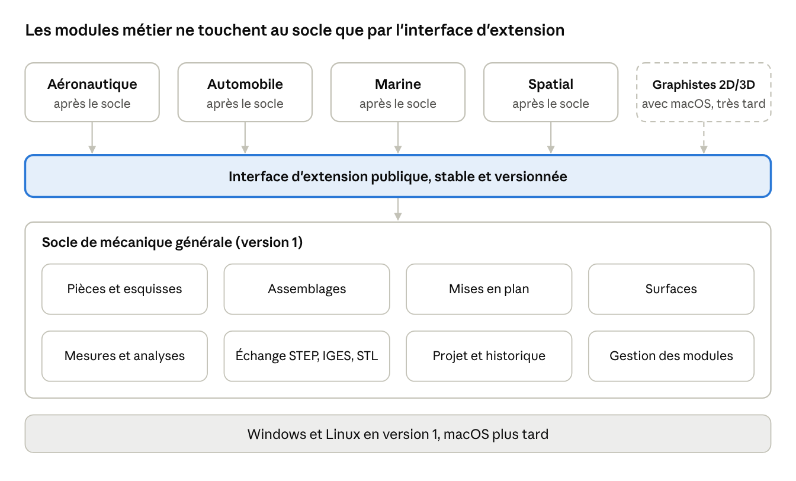

# PersoCAO – Expression du besoin

Version 0.3 (brouillon) · 15 octobre 2026 · Auteur : Fab

## Objet du document

Ce document fixe le besoin de PersoCAO : ce que le logiciel doit permettre, pour qui, et sous quelles contraintes. C'est la première étape du V descendant ; la spécification fonctionnelle, la spécification IHM et l'étude de faisabilité en découleront.

Statut : brouillon v0.3, à relire et valider par Fab. Les besoins de ce document sont tenus dans `reqs/01_besoin.sdoc` (StrictDoc), qui fait foi en cas d'écart ; le tableur de synthèse en est généré.

## Contexte et finalité

PersoCAO est un logiciel de modélisation 3D de mécanique générale, pour un usage personnel, écrit entièrement à partir de zéro. Il offre un socle de CAO mécanique complet, auquel s'ajoutent des modules métier installables séparément (aéronautique, automobile, marine, spatial).

Il fonctionne sans cloud, sans gestion de licences et avec des formats ouverts uniquement. Aucune ressemblance avec un logiciel existant n'est recherchée ; l'aspect graphique sera travaillé en détail au niveau 3 du développement.

## Utilisateurs et cas d'usage

L'utilisateur principal est Fab, qui travaille seul sur son poste. Six cas d'usage structurent le besoin.

| ID | Cas d'usage | Ce que l'utilisateur fait |
| --- | --- | --- |
| CU-01 | Concevoir une pièce | Esquisse un profil coté, le transforme en volume, ajoute perçages, congés et chanfreins, puis modifie les cotes jusqu'à obtenir la pièce voulue. |
| CU-02 | Assembler un mécanisme | Insère plusieurs pièces, les positionne par contraintes et vérifie qu'elles n'interfèrent pas. |
| CU-03 | Produire un plan | Génère les vues 2D cotées d'une pièce ou d'un assemblage et les exporte en PDF ou DXF. |
| CU-04 | Échanger avec d'autres outils | Importe ou exporte un modèle en STEP, IGES ou STL (impression 3D, sous-traitance, autre logiciel). |
| CU-05 | Concevoir une forme libre | Crée des formes que l'extrusion et la révolution ne savent pas décrire (carrosserie, carène, profil d'aile) : courbes guides, surfaces balayées ou lissées, raccords continus, puis fermeture en solide. |
| CU-06 | Étendre le logiciel | Installe un module métier (par exemple aéronautique) qui ajoute ses propres outils, sans réinstaller le socle. |

## Périmètre

Le logiciel se compose d'un socle de mécanique générale, livré en premier, et de modules métier qui s'y branchent par une interface d'extension publique. Un module métier n'utilise que cette interface : il ne modifie jamais le socle.

- **Socle (version 1)** : pièces, esquisses, assemblages, mises en plan, surfaces, mesures, échanges de fichiers, gestionnaire de modules.
- **Modules métier (versions suivantes)** : aéronautique, automobile, marine, spatial. Leur contenu sera spécifié module par module.
- **Version intermédiaire** : module de calcul de structure (résistance des matériaux et éléments finis), usinage, reconstruction d'une pièce depuis sa mise en plan, avant le portage macOS.
- **Évolution très ultérieure** : portage macOS, puis un module pour graphistes (2D et 3D) lié à ce portage.

Le socle est livré seul en version 1 ; chaque module métier s'y branche ensuite sans le modifier.

## Besoins fonctionnels

Dix-huit besoins de haut niveau, dont neuf indispensables pour le socle. Chacun sera détaillé en exigences vérifiables dans la spécification fonctionnelle. Priorités : Indispensable (sans lui, pas de version 1), Important (version 1 si possible), Souhaitable (plus tard).

| ID | Besoin | Priorité | Cible | Cas d'usage |
| --- | --- | --- | --- | --- |
| BES-F-01 | Créer des pièces 3D à partir d'esquisses 2D contraintes (par exemple : extrusion, poche, révolution, perçage, congé, chanfrein, dépouille, coque, répétitions, symétrie). | Indispensable | Socle v1 | CU-01 |
| BES-F-02 | Modifier à tout moment une cote ou une étape de l'historique, avec recalcul automatique de tout ce qui en dépend. | Indispensable | Socle v1 | CU-01 |
| BES-F-03 | Annuler et rétablir toute action de modélisation. | Indispensable | Socle v1 | Tous |
| BES-F-04 | Visualiser le modèle en 3D, naviguer (rotation, zoom, déplacement) et sélectionner faces, arêtes et sommets ; afficher ou masquer des pièces et des faces ; réaliser des coupes (un ou plusieurs plans de coupe) pour voir l'intérieur. | Indispensable | Socle v1 | Tous |
| BES-F-05 | Assembler des pièces par contraintes de position et détecter les interférences. | Indispensable | Socle v1 | CU-02 |
| BES-F-06 | Importer et exporter en STEP, IGES et STL. | Indispensable | Socle v1 | CU-04 |
| BES-F-07 | Enregistrer et rouvrir un projet dans un format ouvert, avec tout son historique paramétrique. | Indispensable | Socle v1 | Tous |
| BES-F-08 | Installer, activer et désactiver des modules métier sans recompiler le socle. | Indispensable | Socle v1 | CU-06 |
| BES-F-09 | Produire des mises en plan 2D cotées (vues, coupes, nomenclature) exportées en PDF et DXF. | Important | Socle v1 | CU-03 |
| BES-F-10 | Créer des surfaces complexes (balayage, lissage, raccordement) et les convertir en solide. | Important | Socle v1 | CU-05 |
| BES-F-11 | Mesurer et analyser : distances, angles, volume, masse, centre de gravité, inerties, matériaux. | Important | Socle v1 | CU-01, CU-02 |
| BES-F-12 | Définir des paramètres nommés et des formules qui pilotent les cotes. | Important | Socle v1 | CU-01 |
| BES-F-13 | Automatiser des tâches par script (macros). | Souhaitable | Socle v2 | CU-06 |
| BES-F-14 | Calculer par éléments finis la tenue d'une pièce ou d'un assemblage (contraintes, déformations), dans un module complet qui inclut les outils de résistance des matériaux (poutres, flexion, torsion, flambement) avec leurs équations de référence, documentées et vérifiées sur des cas connus. | Souhaitable | Version intermédiaire | CU-01, CU-02 |
| BES-F-15 | Préparer l'usinage d'une pièce (trajectoires d'outil, export pour machine à commande numérique). | Souhaitable | Version intermédiaire | CU-01 |
| BES-F-16 | Gérer les données produit pour un utilisateur seul : référence et indice de révision de chaque pièce, état (en cours, validé, périmé), cas d'emploi (où une pièce est utilisée), nomenclature. | Important | Socle v1 | CU-02, CU-03 |
| BES-F-17 | Disposer dans chaque pièce et chaque assemblage d'un repère absolu (origine, axes X, Y, Z, trois plans principaux), créer des repères locaux et positionner tout élément par rapport à l'un d'eux. Unités choisies par document (millimètre par défaut). | Indispensable | Socle v1 | CU-01, CU-02, CU-04 |
| BES-F-18 | Reconstruire une pièce 3D à partir de sa mise en plan 2D (vues cotées). | Souhaitable | Version intermédiaire | CU-03 |

Les besoins propres aux modules métier (profils d'aile, carènes et hydrostatique, etc.) seront exprimés dans un document par module.

## Besoins techniques

Les valeurs chiffrées marquées « proposition » sont des points de départ à valider, pas des engagements.

| ID | Besoin | Priorité |
| --- | --- | --- |
| BES-T-01 | Fonctionner sur Windows 10/11 et Linux, en 64 bits. L'architecture ne doit pas empêcher un portage macOS ultérieur. | Indispensable |
| BES-T-02 | Fonctionner entièrement hors ligne : aucun compte, aucune licence, aucune télémétrie. | Indispensable |
| BES-T-03 | Utiliser uniquement des formats ouverts et documentés ; un projet enregistré reste lisible par toutes les versions suivantes. | Indispensable |
| BES-T-04 | Ne jamais perdre le travail : sauvegarde automatique et récupération après un plantage. | Indispensable |
| BES-T-05 | Rester fluide sans jamais sacrifier la précision de calcul (BES-T-10). Proposition : rotation à 30 images par seconde minimum sur un assemblage de 200 pièces, recalcul d'une opération simple en moins d'une seconde. | Important |
| BES-T-06 | Offrir une interface d'extension stable et versionnée, pour que les modules métier survivent aux mises à jour du socle. | Indispensable |
| BES-T-07 | Code, icônes et ressources 100 % originaux ; aucune réutilisation d'un logiciel propriétaire ; licences des dépendances compatibles avec l'usage prévu. | Indispensable |
| BES-T-08 | Interface en français, préparée pour la traduction. | Important |
| BES-T-09 | Être maintenable : tests automatisés, intégration continue, gestion de configuration sous Git. | Indispensable |
| BES-T-10 | Privilégier la précision de calcul : géométrie exacte dans les calculs (jamais l'approximation en triangles de l'affichage), tolérances maîtrisées et documentées, résultats (mesures, masses, calculs de structure) vérifiés sur des cas de référence. En cas de conflit, la précision prime sur la fluidité. | Indispensable |

## Contraintes de développement

Le logiciel est développé directement en C++20 avec Qt 6 pour l'interface et Open CASCADE pour le noyau géométrique. Python n'intervient qu'à deux endroits : des prototypes jetables qui lèvent les risques techniques avant le codage, et le langage de script et de modules métier (BES-F-13). La gestion de configuration se fait sous Git ; le dépôt privé PersoCAO a été créé par Fab sur GitHub.

### Pourquoi pas un prototype Python porté ensuite

Écrire tout le logiciel en Python puis le porter revient à écrire chaque fonctionnalité deux fois. Le C++ coûte plus cher par fonctionnalité (code plus long, build plus lourd, cycles de compilation), mais moins cher au total, et il supprime le risque de divergence entre deux versions. Ce raisonnement repose sur une estimation, pas sur une mesure.

### Prototypes de levée de risque

Chaque prototype répond à une seule question, puis il est jeté : seuls ses enseignements et ses cas de test passent dans le logiciel. Ils seront planifiés dans l'étude de faisabilité.

| Prototype | Question à trancher | Langage |
| --- | --- | --- |
| Viewer 3D | Peut-on afficher, naviguer et sélectionner faces et arêtes avec fluidité dans une fenêtre Qt, sur Windows et sur Linux ? | Python (PySide6 et OCP), pour aller vite |
| Solveur d'esquisse | Quelle bibliothèque existante (planegcs, SolveSpace) résout de façon stable les esquisses visées ? | Selon la bibliothèque |
| Historique et désignation des faces | Une face référencée par une opération garde-t-elle son identité quand on modifie une cote en amont ? | Python |
| Chargement des modules | Peut-on charger un module compilé séparément, sans recompiler le socle, sur les deux systèmes ? | C++ |

Dans le produit final, l'API de script Python est exposée par une liaison (pybind11) au-dessus du cœur C++, sur le modèle de logiciels de CAO existants.

## Hors périmètre

- Lecture ou écriture de formats propriétaires d'autres logiciels de CAO en version 1 : le cadre légal est à étudier avant toute décision (voir points ouverts).
- Cloud, travail collaboratif en ligne, comptes utilisateurs, gestion de licences.
- Gestion de données produit (PLM/PDM) : versions de pièces, workflows de validation, à plusieurs utilisateurs avec un serveur ; une gestion légère pour un utilisateur seul est intégrée au besoin (BES-F-16).
- Calcul par éléments finis et usinage, dans la version 1 : prévus dans une version intermédiaire, avant le portage macOS (BES-F-14 et BES-F-15).
- macOS et le module pour graphistes, dans la version 1.
- Ressemblance visuelle avec un logiciel existant.

## Gestion des exigences

Recommandation : tenir les exigences en fichiers texte dans le dépôt Git, et générer le tableur de synthèse à partir d'eux. Un tableur seul convient pour démarrer, mais sous Git c'est un fichier binaire : pas de diff lisible, fusions impossibles, et les liens de traçabilité s'y cassent facilement.

L'outil proposé est [StrictDoc](https://github.com/strictdoc-project/strictdoc), open source, conçu pour ce besoin : exigences identifiées dans des fichiers texte, liens parent-enfant entre niveaux, matrice de traçabilité et vues HTML ou tableur générées. Les exigences sont tenues sous StrictDoc dans le dossier `reqs/` du dépôt ; le tableur et la matrice de traçabilité sont générés par `tools/generer_vues.sh`.

Chaque exigence porte un identifiant stable et le lien vers son parent :

| Préfixe | Niveau du V | Document |
| --- | --- | --- |
| BES-F / BES-T | Besoin | Ce document |
| EXF | Exigence fonctionnelle | Spécification fonctionnelle |
| EXI | Exigence d'interface et de rendu | Spécification IHM |
| EXT | Exigence technique | Spécification fonctionnelle |
| CON | Élément de conception | Conception générale |
| TST | Test de vérification | Plans de test (branche montante du V) |

Une exigence sans parent, ou un besoin sans exigence ni test, est signalé automatiquement par la matrice.

## Jalons de développement

Les jalons démarrent une fois le V descendant terminé. Les jalons 1 à 5 forment le socle v1 ; les jalons 1 et 2 sont réalistes rapidement, les suivants sont de gros chantiers. La colonne des besoins couverts est une proposition à valider.

| Jalon | Contenu | Besoins couverts |
| --- | --- | --- |
| 1. Base | Fenêtre principale, viewer 3D (rotation, zoom, déplacement), sélection, arbre de spécifications, compas, repères, chargement des modules. | BES-F-04, 08, 17 |
| 2. Pièces | Esquisses 2D contraintes, extrusion, poche, révolution, congés, chanfreins, dépouilles, répétitions, symétrie, historique paramétrique modifiable. | BES-F-01, 02, 03, 06, 07, 12 |
| 3. Assemblages | Arbre de produit, contraintes d'assemblage (coïncidence, contact, décalage, angle), détection des collisions. | BES-F-05, 11, 16 |
| 4. Mises en plan | Vues 2D et coupes à partir du 3D, cotation, export DXF et PDF. | BES-F-09 |
| 5. Surfaces | Surfaces avancées, balayage, lissage, raccordement. | BES-F-10 |
| 6. Version intermédiaire | Module de calcul de structure (RDM et éléments finis), usinage, reconstruction d'une pièce depuis sa mise en plan. | BES-F-14, 15, 18 |
| 7. Modules métier | Aéronautique (profils d'ailes, import de profils), automobile, marine, spatial. | BES-F-13 et besoins propres à chaque module |
| 8. macOS | Portage macOS, puis module pour graphistes 2D et 3D. | Hors version 1 |

Le solveur de contraintes d'esquisse est la partie la plus difficile du jalon 2 ; il est prévu de réutiliser une bibliothèque existante. L'ordre entre les jalons 6 et 7 reste à confirmer ; l'interface d'extension (BES-F-08) est posée dès le jalon 1 pour que le jalon 7 soit possible sans toucher au socle.

## Points ouverts et prochaines étapes

- [ ] Valider ou corriger les besoins et leurs priorités.
- [ ] Fixer la taille de modèle visée (nombre de pièces d'un assemblage type), qui dimensionne BES-T-05. Estimation de départ : quelques centaines de pièces, à mesurer avec le prototype de viewer 3D.
- [ ] Étudier le cadre légal de la lecture et de l'écriture des formats propriétaires d'autres logiciels de CAO (interopérabilité), puis décider s'il entre dans une version ultérieure.
- [ ] Choisir la distribution Linux de référence (par exemple Ubuntu LTS).
- [x] Décider si PersoCAO restera privé ou pourra être publié un jour : cela conditionne le choix de licence et les obligations liées à Qt et Open CASCADE. Décision : PersoCAO restera privé.
- [ ] Valider la liste des prototypes de levée de risque.
- [ ] Préciser ce que recouvrent les niveaux de développement (le niveau 3 étant celui du travail graphique détaillé).
- [x] Choisir le nom définitif (« PersoCAO » est un nom de travail).

Après validation : spécification fonctionnelle du socle (exigences EXF et EXT), puis spécification IHM et étude de faisabilité.
